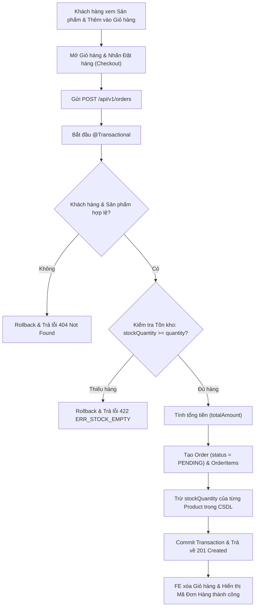
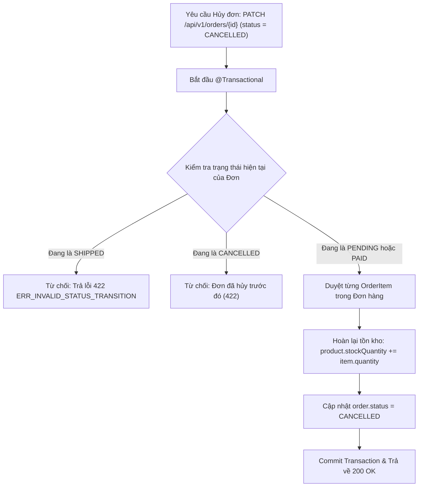
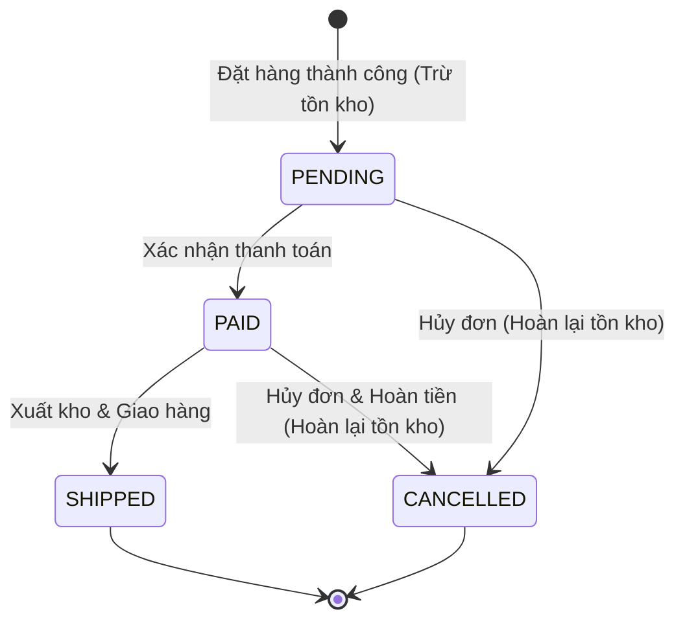

# TÀI LIỆU PHÂN TÍCH NGHIỆP VỤ (BUSINESS ANALYSIS - BA)
**Dự án:** Hệ thống Thương mại Điện tử `SHOP_E` (Fullstack Spring Boot & API-First)  
**Phiên bản:** 1.0  
**Ngày cập nhật:** 30/10/2026

---

## 1. Tổng quan Hệ thống & Phân hệ (Module Overview)

Hệ thống **SHOP E-COMMERCE (`SHOP_E`)** là nền tảng bán hàng trực tuyến kết hợp cổng quản trị vận hành, được thiết kế theo phương pháp **API-First (OpenAPI 3.0)** và kiến trúc phân tầng **Spring Boot + JPA + Tailwind CSS UI**. Hệ thống gồm 3 phân hệ nghiệp vụ cốt lõi:

1. **Module Khách hàng (`Customers`)**: Quản lý vòng đời tài khoản khách hàng gồm đăng ký, đăng nhập xác thực, cập nhật thông tin cá nhân và tra cứu lịch sử đơn hàng đã đặt.
2. **Module Danh mục & Sản phẩm (`Categories & Products`)**: Quản lý danh mục hàng hóa và thông tin chi tiết sản phẩm (mã SKU, tên, giá bán, hình ảnh, mô tả, số lượng tồn kho `stockQuantity`). Hỗ trợ tìm kiếm từ khóa, lọc theo danh mục, lọc theo khoảng giá và phân trang.
3. **Module Giỏ hàng & Đặt hàng (`Cart & Orders`)**: Quản lý giỏ hàng động phía người dùng (thêm, cập nhật số lượng, xóa sản phẩm), xử lý giao dịch Đặt hàng (`Checkout`) đảm bảo tính toàn vẹn ACID (`@Transactional`), và quản lý quy trình chuyển đổi trạng thái đơn hàng (`PENDING` -> `PAID` -> `SHIPPED` / `CANCELLED`) kèm cơ chế hoàn tồn kho tự động khi hủy đơn.

---

## 2. Danh sách Tác nhân (Actors)

| Mã Actor | Tên Actor | Mô tả vai trò |
| :--- | :--- | :--- |
| **ACT-01** | **Khách vãng lai (Guest)** | Xem danh sách sản phẩm, tìm kiếm, lọc theo danh mục/khoảng giá, xem chi tiết sản phẩm, thêm sản phẩm vào giỏ hàng tạm, đăng ký tài khoản mới. |
| **ACT-02** | **Khách hàng (Customer)** | Kế thừa quyền của Guest; thực hiện đăng nhập, quản lý thông tin cá nhân (Họ tên, Email, SĐT, Địa chỉ), thực hiện Đặt hàng (Checkout), xem lịch sử đơn hàng và yêu cầu hủy đơn khi đơn đang ở trạng thái `PENDING`. |
| **ACT-03** | **Quản trị viên (Admin)** | Quản lý danh mục, thêm/sửa/xóa sản phẩm, điều chỉnh tồn kho (`stockQuantity`), theo dõi toàn bộ đơn hàng và chuyển đổi trạng thái đơn hàng (`PENDING` -> `PAID` -> `SHIPPED` hoặc `CANCELLED`). |

---

## 3. Danh sách User Stories & Use Cases (Theo 3 Module)

### 3.1. Module Khách hàng (Customers)

| Mã US / UC | User Story | Tiêu chí chấp nhận (Acceptance Criteria) |
| :--- | :--- | :--- |
| **US-CUS-01** (`UC-01`) | Là **Khách vãng lai**, tôi muốn **đăng ký tài khoản** bằng Họ tên, Email, Số điện thoại, Mật khẩu và Địa chỉ để có thể đặt hàng. | - Email đúng định dạng chuẩn RFC và chưa tồn tại trong hệ thống.<br>- Số điện thoại đúng chuẩn Việt Nam (`10-11` chữ số, bắt đầu bằng `0` hoặc `+84`).<br>- Tạo mới thành công trả về `201 Created`. |
| **US-CUS-02** (`UC-02`) | Là **Khách hàng**, tôi muốn **đăng nhập tài khoản** bằng Email và Mật khẩu để hệ thống nhận diện thông tin đặt hàng của tôi. | - Kiểm tra khớp Email và mật khẩu.<br>- Nếu sai thông tin, trả về lỗi `400/422` với mã `ERR_INVALID_CREDENTIALS`. |
| **US-CUS-03** (`UC-03`) | Là **Khách hàng**, tôi muốn **xem và cập nhật thông tin cá nhân** (Họ tên, SĐT, Địa chỉ giao hàng) để thuận tiện khi thanh toán. | - Validate SĐT và Email hợp lệ khi cập nhật.<br>- Không cho phép đổi sang Email đã thuộc về tài khoản khác (`ERR_DUPLICATE_EMAIL`). |
| **US-CUS-04** (`UC-04`) | Là **Khách hàng**, tôi muốn **xem lịch sử đơn hàng** của mình để theo dõi trạng thái giao hàng và chi tiết từng đơn. | - Hiển thị danh sách đơn hàng của đúng khách hàng theo thứ tự mới nhất trước, kèm trạng thái (`PENDING`, `PAID`, `SHIPPED`, `CANCELLED`). |

### 3.2. Module Danh mục & Sản phẩm (Categories & Products)

| Mã US / UC | User Story | Tiêu chí chấp nhận (Acceptance Criteria) |
| :--- | :--- | :--- |
| **US-PRD-01** (`UC-05`) | Là **Khách hàng**, tôi muốn **xem danh sách sản phẩm có phân trang, tìm kiếm và lọc theo danh mục / khoảng giá** để nhanh chóng tìm được món hàng phù hợp. | - Hỗ trợ tham số `keyword`, `categoryId`, `minPrice`, `maxPrice`, `page`, `size`, `sort`.<br>- Hiển thị rõ giá bán, ảnh, danh mục và số lượng tồn kho (`stockQuantity`). |
| **US-PRD-02** (`UC-06`) | Là **Khách hàng**, tôi muốn **xem chi tiết một sản phẩm** để biết mô tả đầy đủ, tình trạng còn hàng và thêm vào giỏ. | - Nếu ID không tồn tại, trả về `404 Not Found` (`ERR_PRODUCT_NOT_FOUND`).<br>- Nút "Thêm vào giỏ" bị vô hiệu hóa nếu `stockQuantity == 0`. |
| **US-PRD-03** (`UC-07`) | Là **Quản trị viên**, tôi muốn **quản lý danh mục và sản phẩm (Thêm / Sửa / Cập nhật tồn kho / Xóa)** để duy trì danh mục hàng hóa trên cửa hàng. | - Giá bán `price > 0`, tồn kho `stockQuantity >= 0`.<br>- Xóa sản phẩm trả về `204 No Content` (hoặc chặn xóa nếu sản phẩm đã phát sinh trong đơn hàng). |

### 3.3. Module Giỏ hàng & Đặt hàng (Cart & Orders)

| Mã US / UC | User Story | Tiêu chí chấp nhận (Acceptance Criteria) |
| :--- | :--- | :--- |
| **US-ORD-01** (`UC-08`) | Là **Khách hàng**, tôi muốn **thêm/sửa/xóa sản phẩm trong giỏ hàng động** và xem tổng tiền tạm tính ngay trên giao diện. | - Tăng/giảm số lượng cập nhật ngay thành tiền từng dòng và tổng tiền giỏ hàng.<br>- Không cho chọn số lượng vượt quá `stockQuantity` hiện tại. |
| **US-ORD-02** (`UC-09`) | Là **Khách hàng**, tôi muốn **bấm Đặt hàng (Checkout)** để tạo đơn hàng mới từ giỏ hàng hiện tại. | - Kiểm tra tồn kho của toàn bộ sản phẩm trong đơn.<br>- Nếu bất kỳ sản phẩm nào không đủ tồn kho: hủy giao dịch (rollback), trả về `422 Unprocessable Entity` với `code = "ERR_STOCK_EMPTY"`.<br>- Nếu đủ tồn kho: tính tổng tiền, lưu đơn ở trạng thái `PENDING`, trừ `stockQuantity` tương ứng trong cùng 1 `@Transactional`, trả về `201 Created` kèm mã đơn hàng (`orderCode`). |
| **US-ORD-03** (`UC-10`) | Là **Quản trị viên**, tôi muốn **cập nhật trạng thái đơn hàng (`PENDING` -> `PAID` -> `SHIPPED`)** để phản ánh tiến độ xử lý và giao hàng. | - Chỉ cho phép chuyển trạng thái theo đúng luồng hợp lệ.<br>- Mọi thao tác chuyển trạng thái sai quy tắc trả về `422 Unprocessable Entity` (`ERR_INVALID_STATUS_TRANSITION`). |
| **US-ORD-04** (`UC-11`) | Là **Khách hàng / Quản trị viên**, tôi muốn **hủy đơn hàng (`CANCELLED`)** khi đơn chưa giao và hệ thống phải tự động hoàn lại tồn kho. | - Chỉ cho phép hủy khi đơn đang ở `PENDING` (hoặc `PAID` do Admin hủy).<br>- Đơn đã `SHIPPED` không được phép hủy.<br>- Khi chuyển sang `CANCELLED`, số lượng từng sản phẩm trong đơn được cộng trả lại vào `stockQuantity` trong cùng `@Transactional`. |

---

## 4. Đặc tả Chi tiết Use Case Trọng tâm (Use Case Details)

### UC-09: Đặt hàng (Checkout)
- **Actor chính**: Khách hàng (`Customer`)
- **Preconditions**:
  1. Khách hàng đã chọn ít nhất 1 sản phẩm trong giỏ hàng (`items` không rỗng).
  2. Khách hàng đã đăng nhập hoặc cung cấp `customerId` hợp lệ cùng địa chỉ nhận hàng.
- **Main Success Scenario (Luồng chính)**:
  1. Khách hàng kiểm tra giỏ hàng, nhập địa chỉ giao hàng / ghi chú và nhấn **"Đặt hàng (Checkout)"**.
  2. Frontend gửi request `POST /api/v1/orders` gồm `customerId`, `shippingAddress`, `note`, và danh sách `items[{productId, quantity}]`.
  3. Hệ thống mở giao dịch `@Transactional` (read-write).
  4. Hệ thống kiểm tra sự tồn tại của `Customer` theo `customerId`.
  5. Với mỗi dòng `item`, hệ thống truy vấn `Product` trong CSDL và kiểm tra `product.stockQuantity >= item.quantity`.
  6. Hệ thống tính thành tiền từng dòng `subtotal = product.price * item.quantity` và tổng tiền đơn hàng `totalAmount = sum(subtotal)`.
  7. Hệ thống trừ tồn kho: `product.stockQuantity = product.stockQuantity - item.quantity`.
  8. Hệ thống tạo bản ghi `Order` với mã đơn duy nhất (`ORD-...`), trạng thái `PENDING`, lưu các bản ghi `OrderItem` và commit giao dịch.
  9. Hệ thống trả về HTTP `201 Created` kèm thông tin đơn hàng vừa tạo.
  10. Giao diện xóa giỏ hàng và hiển thị màn hình hoàn tất đơn hàng kèm mã `orderCode`.
- **Alternative / Exception Flows (Luồng ngoại lệ)**:
  - **4a. Khách hàng không tồn tại**: Rollback, trả về HTTP `404 Not Found` (`code: "ERR_CUSTOMER_NOT_FOUND"`).
  - **5a. Sản phẩm không tồn tại**: Rollback, trả về HTTP `404 Not Found` (`code: "ERR_PRODUCT_NOT_FOUND"`).
  - **5b. Tồn kho không đủ (`stockQuantity < quantity`)**: Rollback toàn bộ giao dịch (không trừ kho bất kỳ sản phẩm nào), trả về HTTP `422 Unprocessable Entity`:
    ```json
    {
      "code": "ERR_STOCK_EMPTY",
      "message": "Sản phẩm đã hết hàng hoặc không đủ số lượng tồn kho",
      "details": ["Sản phẩm 'Tai nghe Không dây Pro' chỉ còn 2 sản phẩm trong kho (yêu cầu: 5)"]
    }
    ```

### UC-10 & UC-11: Chuyển đổi Trạng thái & Hủy Đơn hàng
- **Actor chính**: Quản trị viên (`Admin`) hoặc Khách hàng (`Customer` khi hủy đơn `PENDING`)
- **Preconditions**: Đơn hàng đã tồn tại trong hệ thống.
- **Main Success Scenario (Luồng chính)**:
  1. Người dùng gửi yêu cầu `PATCH /api/v1/orders/{id}` với payload `{"status": "<NEW_STATUS>"}`.
  2. Hệ thống mở giao dịch `@Transactional`.
  3. Hệ thống kiểm tra trạng thái hiện tại (`currentStatus`) và trạng thái đích (`newStatus`) theo ma trận chuyển đổi hợp lệ:
     - `PENDING` -> `PAID` hoặc `CANCELLED`
     - `PAID` -> `SHIPPED` hoặc `CANCELLED`
  4. Nếu `newStatus == CANCELLED`: Hệ thống duyệt qua toàn bộ `OrderItem` của đơn hàng và cộng hoàn lại tồn kho cho từng sản phẩm:
     `product.stockQuantity = product.stockQuantity + item.quantity`.
  5. Hệ thống cập nhật `order.status = newStatus`, lưu thời gian cập nhật và commit giao dịch.
  6. Hệ thống trả về HTTP `200 OK` kèm thông tin đơn hàng đã cập nhật.
- **Alternative / Exception Flows**:
  - **3a. Chuyển trạng thái không hợp lệ** (ví dụ: từ `SHIPPED` sang `CANCELLED`, từ `CANCELLED` sang `PAID`, hoặc từ `PENDING` nhảy thẳng sang `SHIPPED`): Rollback, trả về HTTP `422 Unprocessable Entity` với `code = "ERR_INVALID_STATUS_TRANSITION"`.

---

## 5. Sơ đồ Luồng Nghiệp vụ (Business Workflow Diagrams)

### 5.1. Sơ đồ Luồng Nghiệp vụ Đặt hàng (Checkout Flow)



### 5.2. Sơ đồ Luồng Nghiệp vụ Hủy đơn & Hoàn Tồn kho (Cancel & Restock Flow)



### 5.3. Sơ đồ Máy Trạng thái Đơn hàng (Order State Machine)



---

## 6. Quy tắc Nghiệp vụ Bắt buộc (Business Rules Catalog)

| Mã Rule | Quy tắc nghiệp vụ | Mã lỗi liên quan |
| :--- | :--- | :--- |
| **BR-CUS-01** | Email khách hàng phải đúng định dạng chuẩn và là duy nhất trong toàn hệ thống. | `ERR_VALIDATION_FAILED`, `ERR_DUPLICATE_EMAIL` |
| **BR-CUS-02** | Số điện thoại khách hàng phải khớp biểu thức chính quy `^(\+84\|0)[35789][0-9]{8}$` (hoặc 10–11 chữ số hợp lệ). | `ERR_VALIDATION_FAILED` |
| **BR-PRD-01** | Giá bán sản phẩm (`price`) phải lớn hơn `0`; số lượng tồn kho (`stockQuantity`) phải `>= 0`. | `ERR_VALIDATION_FAILED` |
| **BR-ORD-01** | Đơn hàng phải có ít nhất 1 sản phẩm (`items.size >= 1`), số lượng đặt mỗi sản phẩm phải `>= 1`. | `ERR_VALIDATION_FAILED` |
| **BR-ORD-02** | Khi đặt hàng, nếu bất kỳ sản phẩm nào có `stockQuantity < quantity` yêu cầu thì toàn bộ đơn hàng bị từ chối và không có sản phẩm nào bị trừ kho (đảm bảo tính nguyên tử ACID). | `ERR_STOCK_EMPTY` |
| **BR-ORD-03** | Đơn hàng mới tạo luôn khởi đầu ở trạng thái `PENDING`. | - |
| **BR-ORD-04** | Trạng thái đơn hàng chỉ được phép chuyển theo luồng: `PENDING -> PAID -> SHIPPED` hoặc `PENDING/PAID -> CANCELLED`. Không được nhảy cóc từ `PENDING` sang `SHIPPED` và không được hủy đơn đã `SHIPPED`. | `ERR_INVALID_STATUS_TRANSITION` |
| **BR-ORD-05** | Khi đơn hàng chuyển sang `CANCELLED`, hệ thống bắt buộc cộng trả lại đúng số lượng đã đặt của từng sản phẩm vào `Product.stockQuantity`. | - |

---

## 7. Ma trận Ánh xạ Nghiệp vụ - API - Màn hình - CSDL (Traceability Matrix)

| Phân hệ | Use Case | RESTful Endpoint | Màn hình UI | Bảng CSDL tác động |
| :--- | :--- | :--- | :--- | :--- |
| **Customers** | Đăng ký tài khoản | `POST /api/v1/customers` | Storefront -> Modal Tài khoản (Tab Đăng ký) | `customers` |
| **Customers** | Đăng nhập | `POST /api/v1/customers/sessions` | Storefront -> Modal Tài khoản (Tab Đăng nhập) | `customers` |
| **Customers** | Cập nhật hồ sơ | `PUT /api/v1/customers/{id}` | Storefront -> Modal Hồ sơ cá nhân | `customers` |
| **Customers** | Xem lịch sử đơn | `GET /api/v1/customers/{id}/orders` | Storefront -> Lịch sử đơn hàng | `orders`, `order_items` |
| **Products** | Tìm kiếm, lọc, phân trang | `GET /api/v1/products` | Storefront (Trang chủ) & Admin Products | `products`, `categories` |
| **Products** | Xem chi tiết sản phẩm | `GET /api/v1/products/{id}` | Storefront -> Modal Chi tiết sản phẩm | `products`, `categories` |
| **Products** | Quản lý sản phẩm & kho | `POST/PUT/PATCH/DELETE /api/v1/products` | Admin Dashboard -> Tab Sản phẩm & Tồn kho | `products` |
| **Orders** | Đặt hàng (Checkout) | `POST /api/v1/orders` | Storefront -> Drawer Giỏ hàng & Checkout | `orders`, `order_items`, `products` |
| **Orders** | Quản lý & Đổi trạng thái đơn | `GET /api/v1/orders`, `PATCH /api/v1/orders/{id}` | Admin Dashboard -> Tab Đơn hàng & Storefront Lịch sử đơn | `orders`, `order_items`, `products` |

---

## 8. Open Questions / Giả định Nghiệp vụ Đã Chốt

1. **Giỏ hàng (Cart Storage)**: Giỏ hàng được quản lý động ở phía Client (`localStorage` kết hợp kiểm tra tồn kho trực tiếp từ API sản phẩm) và khi bấm **Đặt hàng (Checkout)** sẽ gửi toàn bộ danh sách mặt hàng lên `POST /api/v1/orders` để xử lý giao dịch ACID tại Backend.
2. **Xác thực khách hàng**: Hỗ trợ đăng ký/đăng nhập nhanh bằng Email & mật khẩu (hoặc chọn nhanh khách hàng mẫu được seed sẵn bởi Faker trên giao diện để giảng viên/tester kiểm thử chỉ với 1 cú click).
3. **Chính sách hủy đơn đã thanh toán (`PAID`)**: Cho phép hủy đơn ở trạng thái `PENDING` (bởi Khách hàng hoặc Admin) và `PAID` (bởi Admin trước khi giao vận), cả hai trường hợp đều hoàn lại số lượng tồn kho (`stockQuantity`). Đơn đã `SHIPPED` tuyệt đối không thể hủy.

