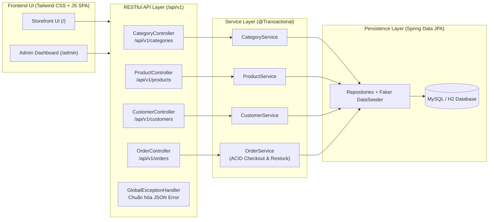
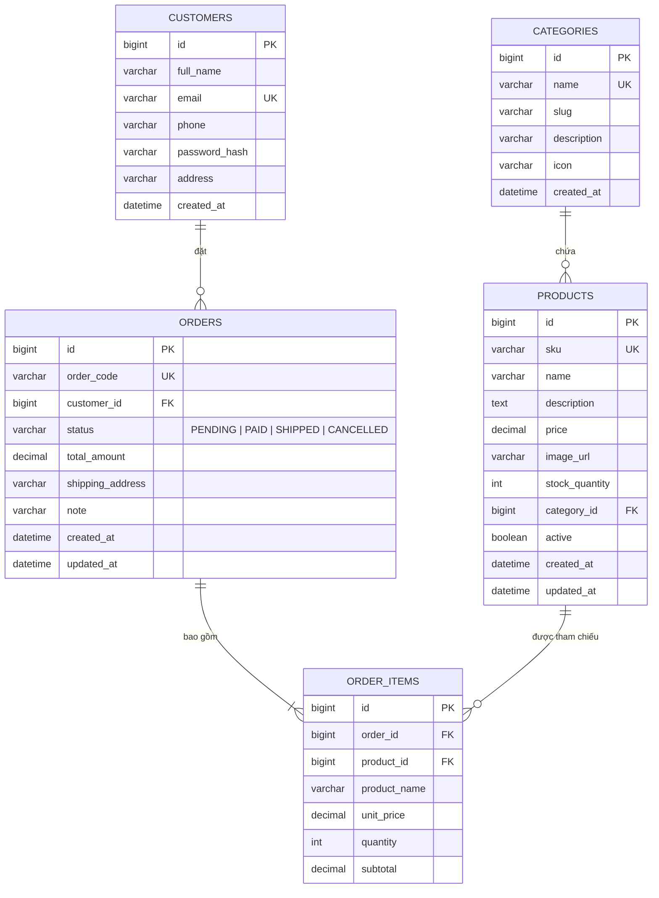
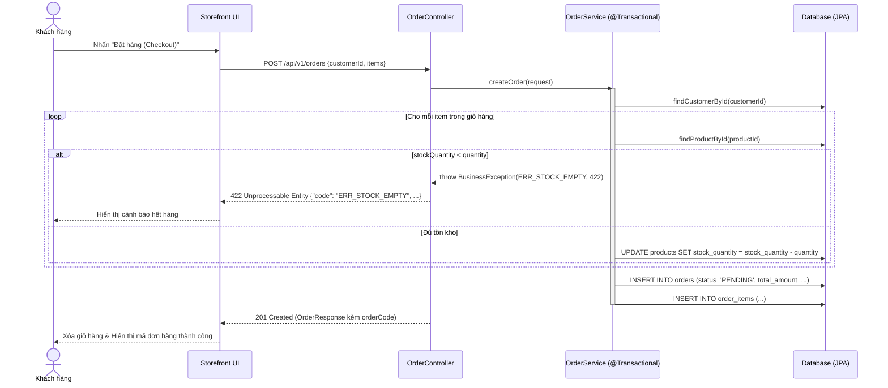

# TÀI LIỆU ĐẶC TẢ KỸ THUẬT & THIẾT KẾ API-FIRST (SA & API SPECIFICATION)
**Dự án:** Hệ thống Thương mại Điện tử `SHOP_E` (Fullstack Spring Boot & API-First)  
**Phiên bản:** 1.0  
**Ngày cập nhật:** 30/10/2026

---

## 1. Tổng quan Kiến trúc Hệ thống (Architecture Overview)

Hệ thống `SHOP_E` tuân thủ quy trình **API-First** với file đặc tả **OpenAPI 3.0 (`shop-api.yaml`)** đóng vai trò **Single Source of Truth**.



---

## 2. Chuẩn Nguyên tắc RESTful API & Quy trình API-First

### 2.1. Quy tắc Đặt tên Endpoint (Plural Nouns, Không dùng động từ)
Toàn bộ tài nguyên RESTful sử dụng **danh từ số nhiều** đặt dưới tiền tố `/api/v1`:
- `/api/v1/categories` — Tài nguyên Danh mục hàng hóa
- `/api/v1/products` — Tài nguyên Sản phẩm
- `/api/v1/customers` — Tài nguyên Khách hàng (và `/api/v1/customers/{id}/orders`, `/api/v1/customers/sessions`)
- `/api/v1/orders` — Tài nguyên Đơn hàng

### 2.2. Chuẩn HTTP Verbs & Status Codes

| HTTP Verb | Mục đích sử dụng | Status Code Thành công | Status Code Lỗi tiêu chuẩn |
| :--- | :--- | :--- | :--- |
| `GET` | Truy vấn danh sách (có phân trang/lọc) hoặc chi tiết tài nguyên | `200 OK` | `400 Bad Request`, `404 Not Found` |
| `POST` | Tạo mới tài nguyên (Đăng ký khách hàng, Tạo sản phẩm, Đặt hàng) | `201 Created` | `400 Bad Request`, `404 Not Found`, `422 Unprocessable Entity` |
| `PUT` | Cập nhật toàn phần tài nguyên | `200 OK` | `400 Bad Request`, `404 Not Found`, `422 Unprocessable Entity` |
| `PATCH` | Cập nhật một phần tài nguyên (Cập nhật trạng thái đơn, Cập nhật tồn kho) | `200 OK` | `400 Bad Request`, `404 Not Found`, `422 Unprocessable Entity` |
| `DELETE` | Xóa tài nguyên | `204 No Content` | `404 Not Found`, `422 Unprocessable Entity` |

### 2.3. Cấu trúc Phản hồi Lỗi JSON Thống nhất (Unified Error Format)
Mọi lỗi phát sinh trong hệ thống đều được xử lý bởi `GlobalExceptionHandler` và trả về cùng một cấu trúc JSON chuẩn:

```json
{
  "code": "ERR_STOCK_EMPTY",
  "message": "Sản phẩm đã hết hàng",
  "details": [
    "Sản phẩm 'Laptop Gaming ROG Strix' chỉ còn 2 sản phẩm trong kho (yêu cầu: 5)"
  ]
}
```

**Bảng Mã lỗi Chuẩn hóa (`Error Codes`):**

| HTTP Status | Mã lỗi (`code`) | Ý nghĩa |
| :--- | :--- | :--- |
| `400 Bad Request` | `ERR_VALIDATION_FAILED` | Dữ liệu đầu vào không hợp lệ (Email sai, SĐT sai, giá âm, thiếu trường bắt buộc). |
| `400 Bad Request` | `ERR_BAD_REQUEST` | Cú pháp JSON hoặc tham số truy vấn không hợp lệ. |
| `404 Not Found` | `ERR_RESOURCE_NOT_FOUND` | Không tìm thấy Khách hàng, Danh mục, Sản phẩm hoặc Đơn hàng theo ID. |
| `422 Unprocessable Entity` | `ERR_STOCK_EMPTY` | Sản phẩm đã hết hàng hoặc số lượng tồn kho không đủ đáp ứng đơn đặt hàng. |
| `422 Unprocessable Entity` | `ERR_INVALID_STATUS_TRANSITION` | Chuyển đổi trạng thái đơn hàng vi phạm quy tắc nghiệp vụ. |
| `422 Unprocessable Entity` | `ERR_DUPLICATE_EMAIL` | Email đăng ký đã tồn tại trong hệ thống. |
| `422 Unprocessable Entity` | `ERR_INVALID_CREDENTIALS` | Email hoặc mật khẩu đăng nhập không chính xác. |
| `422 Unprocessable Entity` | `ERR_RESOURCE_IN_USE` | Không thể xóa danh mục/sản phẩm đã phát sinh dữ liệu ràng buộc. |
| `500 Internal Server Error` | `ERR_INTERNAL_SERVER` | Lỗi hệ thống ngoài dự kiến. |

---

## 3. Đặc tả Chi tiết Các Endpoint (`/api/v1`)

### 3.1. Module Danh mục (`/api/v1/categories`)
- `GET /api/v1/categories`: Lấy danh sách tất cả danh mục sản phẩm (`200 OK`).
- `GET /api/v1/categories/{id}`: Lấy chi tiết 1 danh mục (`200 OK` / `404 Not Found`).
- `POST /api/v1/categories`: Tạo danh mục mới (`201 Created`).
- `PUT /api/v1/categories/{id}`: Cập nhật danh mục (`200 OK`).
- `DELETE /api/v1/categories/{id}`: Xóa danh mục (`204 No Content`).

### 3.2. Module Sản phẩm (`/api/v1/products`)
- `GET /api/v1/products`: Lấy danh sách sản phẩm có tìm kiếm, lọc và phân trang (`200 OK`).
  - Query params:
    - `keyword` (tìm theo tên, mã SKU hoặc mô tả)
    - `categoryId` (lọc theo danh mục)
    - `minPrice`, `maxPrice` (lọc theo khoảng giá bán)
    - `page` (mặc định `0`), `size` (mặc định `8`), `sortBy` (`price`, `createdAt`, `name`), `sortDir` (`asc`, `desc`)
- `GET /api/v1/products/{id}`: Xem chi tiết sản phẩm (`200 OK` / `404 Not Found`).
- `POST /api/v1/products`: Thêm sản phẩm mới (`201 Created`).
- `PUT /api/v1/products/{id}`: Cập nhật thông tin sản phẩm (`200 OK`).
- `PATCH /api/v1/products/{id}`: Cập nhật nhanh số lượng tồn kho `stockQuantity` hoặc giá bán (`200 OK`).
- `DELETE /api/v1/products/{id}`: Xóa sản phẩm (`204 No Content`).

### 3.3. Module Khách hàng (`/api/v1/customers`)
- `GET /api/v1/customers`: Lấy danh sách khách hàng (`200 OK`).
- `GET /api/v1/customers/{id}`: Xem thông tin cá nhân khách hàng (`200 OK` / `404 Not Found`).
- `POST /api/v1/customers`: Đăng ký tài khoản khách hàng mới (`201 Created`).
  - Validate bắt buộc: `email` (`@Email`, unique), `phone` (`^(\+84|0)[0-9]{9,10}$`), `fullName` (`@NotBlank`).
- `POST /api/v1/customers/sessions`: Tạo phiên đăng nhập (xác thực Email & Password, trả về `200 OK` kèm thông tin Customer).
- `PUT /api/v1/customers/{id}`: Cập nhật thông tin cá nhân (`200 OK`).
- `GET /api/v1/customers/{id}/orders`: Xem lịch sử đơn hàng của khách hàng (`200 OK`).

### 3.4. Module Đơn hàng (`/api/v1/orders`)
- `GET /api/v1/orders`: Danh sách đơn hàng có phân trang & lọc theo `status`, `customerId` (`200 OK`).
- `GET /api/v1/orders/{id}`: Xem chi tiết đơn hàng và danh sách mặt hàng (`200 OK` / `404 Not Found`).
- `POST /api/v1/orders`: Đặt hàng mới (`Checkout` - trả về `201 Created`).
  - Request Body:
    ```json
    {
      "customerId": 1,
      "shippingAddress": "123 Nguyễn Huệ, Quận 1, TP.HCM",
      "note": "Giao giờ hành chính",
      "items": [
        { "productId": 1, "quantity": 2 },
        { "productId": 3, "quantity": 1 }
      ]
    }
    ```
- `PATCH /api/v1/orders/{id}`: Chuyển đổi trạng thái đơn hàng (`PENDING` -> `PAID` -> `SHIPPED` hoặc `CANCELLED`) (`200 OK`).
  - Request Body:
    ```json
    {
      "status": "CANCELLED"
    }
    ```

---

## 4. Thiết kế Cơ sở Dữ liệu (ERD & Schema Design)



---

## 5. Thiết kế Giao dịch `@Transactional` & Tối ưu Hiệu năng JPA

### 5.1. Tối ưu Truy vấn Đọc (`@Transactional(readOnly = true)`)
Toàn bộ các lớp Service (`CategoryService`, `ProductService`, `CustomerService`, `OrderService`) được đánh dấu `@Transactional(readOnly = true)` ở mức class hoặc phương thức đọc (`findAll`, `findById`, `searchProducts`, `getCustomerOrders`):
- Giúp **Hibernate tắt cơ chế Dirty Checking** (không cần giữ bản chụp snapshot của entity trong Persistence Context).
- Giảm thiểu tiêu thụ bộ nhớ RAM và CPU khi truy vấn danh sách phân trang.

### 5.2. Giao dịch Đặt hàng ACID (`@Transactional`)
Phương thức `OrderService.createOrder(...)` được đánh dấu `@Transactional`:
```java
@Transactional
public OrderResponse createOrder(OrderCreateRequest request) {
    // 1. Kiểm tra Customer tồn tại
    // 2. Duyệt từng item -> Kiểm tra Product.stockQuantity >= item.quantity
    //    Nếu thiếu hàng -> throw BusinessException("ERR_STOCK_EMPTY", 422) -> Tự động Rollback 100%
    // 3. Trừ tồn kho: product.setStockQuantity(product.getStockQuantity() - item.getQuantity())
    // 4. Tính tổng tiền & Lưu Order (status = PENDING) + OrderItems
}
```

### 5.3. Sequence Diagram Luồng Đặt hàng (Checkout Sequence)



---

## 6. Quy trình OpenAPI Codegen, Mock Server & Contract Testing

1. **Single Source of Truth (`shop-api.yaml`)**:
   - Đặt tại `src/main/resources/openapi/shop-api.yaml` và bản sao tại `docx/shop-api.yaml`, đồng thời được phục vụ trực tiếp qua endpoint `GET /api/v1/openapi.yaml`.
2. **Codegen tự động (`openapi-generator-maven-plugin`)**:
   - Cấu hình trong `pom.xml` sinh tự động các Java Interfaces và DTOs từ `src/main/resources/openapi/shop-api.yaml` vào thư mục `target/generated-sources/openapi`.
3. **Khởi chạy Mock Server & Chuyển đổi 2 Giai đoạn trên UI**:
   - Có thể chạy Mock Server bằng Prism / Postman Mock / Swagger Editor từ `docx/shop-api.yaml`:
     ```bash
     npx @stoplight/prism-cli mock docx/shop-api.yaml -p 4010
     ```
   - Trên thanh công cụ của giao diện **Storefront** và **Admin Dashboard**, người dùng có thể chuyển đổi linh hoạt **Chế độ Kết nối API**:
     - **Giai đoạn 1 (Mock Server / Custom API URL)**: Kết nối tới Mock Server (`http://localhost:4010/api/v1`).
     - **Giai đoạn 2 (Spring Boot Backend)**: Kết nối trực tiếp tới `/api/v1` của ứng dụng Spring Boot.
4. **Kiểm thử Hợp đồng (API Contract Test)**:
   - Bộ Postman Collection được đóng gói tại `docx/shop-api.postman_collection.json`, có thể chạy tự động bằng Newman hoặc Postman Runner:
     ```bash
     npx newman run docx/shop-api.postman_collection.json
     ```

